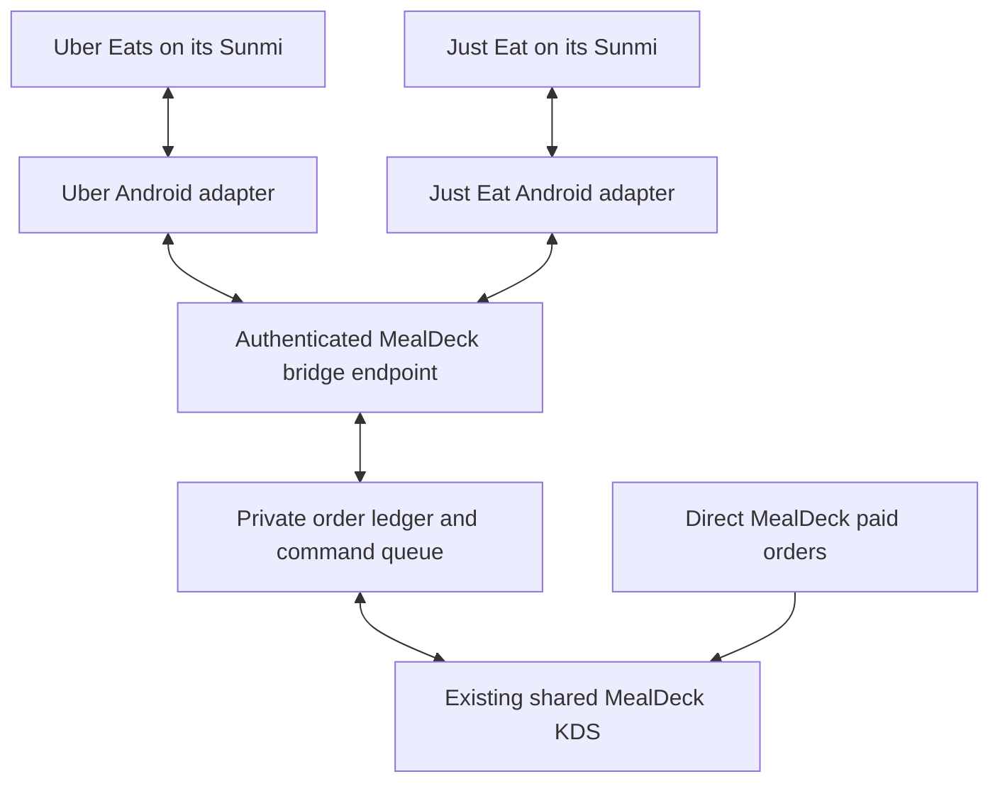

# Owned Uber Eats and Just Eat connectors

## Delivery status

This source implements MealDeck-owned order ingestion, a separate marketplace order ledger, the shared KDS presentation and actions, a durable command queue, a scoped bridge endpoint, and two local UI adapters. There is no UrbanPiper, Otter or HubRise dependency and no model call in normal order processing.

**Source implementation and fixture verification do not establish a live connection.** No Uber Eats account, Just Eat account or Sunmi device was connected during development. No real order was imported, accepted, changed, charged or handed over. All shipped connection examples are disabled and have no store ID, credentials or production selectors.

The owner has confirmed two separate Sunmi terminals: one running Uber Eats and one running Just Eat. Photos supplied on 9 November identify the Uber terminal as SUNMI V3 PLUS (`V3_PLUS`) with Android 14; see the [sanitised device evidence record](mealdeck-marketplace-device-evidence.md). Its merchant app version/package, permitted device access, exact storefront and stable order identifiers, complete screen extraction and action readback remain unverified. Just Eat device details remain pending. A photograph, visible button, browser login or Android hardware brand alone does not establish a live connection.

## What is implemented

| Requirement | Implementation | Live dependency |
| --- | --- | --- |
| Orders in one KDS | Additive private marketplace ledger projected into the existing scoped workflow board | A commissioned connector must read complete real orders |
| Original order reference | Separate string reference, preserving case, letters and leading zeroes; used on active, search and Done cards | The actual customer/courier reference must be exposed by the merchant UI |
| Platform identification | Uber Eats or Just Eat badge on each card | Exact connection-to-store mapping |
| Accept from KDS | Scoped staff action queues acceptance once; kitchen preparation waits for observed platform acceptance | That order's accept control must be supported and observable |
| Preparing | Local preparation always remains distinct; outbound update only when configured | Some workflows communicate preparation during acceptance and have no separate control |
| Ready | Queued after all items are checked, packing starts and the complete order is sealed | The platform's ready control and readback must be available |
| Handover | Staff compares and enters the exact platform reference; local handover is recorded; supported outbound control is queued | Courier collection/delivery remains platform-controlled where no merchant handover control exists |
| Cancellations | Confirmed cancellation blocks kitchen work and further dispatch; scoped acknowledgement removes the active card | The platform's cancelled state must be observable |
| Uncertain action | Persistent dispatch journal and server lease retain uncertainty; later work reconciles without repeating the click | A fresh matching-order readback or staff review on the original merchant screen |

Only the marketplace can decide how its customer app describes those events. A MealDeck local status change does not itself update a customer. A click does not establish success; the adapter must read back the same store, stable order ID, exact display reference and a state that proves the requested action.

## Architecture



The local package is `apps/mealdeck-marketplace-bridge`. It runs on an always-on local computer using Node 24 or later. Both Sunmi connections use a loopback Appium server and specifically selected, authorised Android devices. Each has its own device ID, reviewed app package, UiAutomator2 system port, server connector credential and durable journal. The example system ports are 8201 for Uber and 8202 for Just Eat; both may use the same loopback Appium endpoint on port 4723. The merchant app package must be verified on the actual terminal before activation.

These are Android UI bridges controlled from that local computer, not a claim that standalone Sunmi APKs have been installed. Device administration may prevent the required access. The compatible Appium/UiAutomator2 toolchain and its on-device helpers must be provisioned through authorised setup; routine connection startup must not install helpers, reset or unlock a terminal. If the required access is unavailable, the connector remains unavailable.

The existing Uber Chrome transport remains an optional alternative using a dedicated visible browser profile and normal staff sign-in. Choose one Uber transport per server connection; do not run browser and Android workers against the same connection at once.

### Order identity and money

The internal ledger UUID, stable external order ID and customer/courier display reference are separate. Deduplication uses the provisioned platform/store connection and stable external order ID. A short display code is not a global order key, and an external display reference is not a MealDeck collection secret.

The initial complete marketplace snapshot is immutable. It stores all observed lines, quantities, modifiers, notes, fulfilment, currency and platform total in integer pence. A platform unit price is displayed only when actually observed. An unavailable unit price stays null; the adapter must not derive one from a line total or modifier arithmetic. The platform total is not reconstructed from item sums because fees, discounts and adjustments may differ.

When the source has no line ID, the bridge can assign an explicitly synthetic `ui:` line identity within the frozen snapshot. It never invents a platform order ID or guesses a catalogue SKU by its name. The connection's reviewed store, kitchen, station and optional brand mapping route the complete card.

Marketplace orders do not enter `public.orders`, fabricate a Stripe/cash tender, receive MealDeck direct-order discounts, earn direct-order loyalty, generate a second charge or book another courier. The ordinary MealDeck order sequence, payment authority, collection codes and receipt pipeline remain intact. Marketplace printing, settlement/finance reporting, menu/stock publishing, refunds and courier booking are outside this connector release; the platform's existing receipt and settlement tools remain authoritative.

### Kitchen state versus platform state

The existing six local stages are retained: New, Accepted, Preparing, Ready to pack, Ready for handover and Done. Each marketplace card also shows the last observed platform state and a separate sync state: queued, sending, confirmed, needs checking, unsupported or unconfigured.

Staff acceptance and platform acceptance are separate evidence. An accepted local card cannot start preparation while platform acceptance is still uncertain. Starting packing is not the platform Ready event. Sealing after every item is ready creates that outbound command. Completing local handover is not evidence of customer delivery.

A newer conflicting food snapshot holds the existing card for review without overwriting purchased items. Cancelled cards remain visibly stopped until staff acknowledge the cancellation. That acknowledgement is not a refund, a remote cancellation, a handover or a Done order.

## Runtime and security boundaries

The machine-only endpoint is `POST /api/marketplace/bridge`. Its strict envelope is `{ op, connectorId, payload }`, with `heartbeat`, `observe`, `claim` and `result` operations. `src/lib/mealdeck-marketplace-protocol.ts` defines the complete wire schema.

Each local connector receives its own high-entropy base64url bearer credential. Only its SHA-256 hash is stored in the private database. The browser KDS never receives that token, a Supabase privileged key, merchant cookies or Appium access. The server chooses the configured MealDeck tenant and Luton location; client-supplied scope is rejected. Every database operation rechecks the exact connector, store scope, enabled state, reviewed profile and credential.

The existing dedicated backend configuration is required, together with these server-only activation settings:

```text
MEALDECK_MARKETPLACE_BRIDGE_ENABLED=true
MEALDECK_MARKETPLACE_BRIDGE_APPROVAL=signed-off
```

Both must be explicitly configured after commissioning. A missing or OFF setting blocks the bridge. This is independent of direct checkout activation. Provisioning database rows alone does not enable hosted traffic.

The private tables have RLS enabled and no direct anonymous, authenticated or service-role table access. Narrow service RPCs handle bridge traffic; staff RPCs use current kitchen-scoped permissions and MFA rules. Connection diagnostics use the actual authenticated owner/admin identity, not a service credential or user-editable role claim. API responses are private and uncached; errors return fixed safe descriptions rather than request bodies, credentials or database diagnostics.

The local process uses a persistent SQLite command journal. It records possible dispatch before interacting with the merchant UI. A separate process-ownership lock prevents two local writers and is released by the operating system after process failure. Server leases independently prevent a second worker from executing the same command. Expired or uncertain actions are reconciliation-only; changing a lease or restarting the process never grants permission to repeat a click.

Appium is loopback-only. Chrome sessions use a dedicated local profile. Login, session expiry, unsupported controls, changed views, a lost device and ambiguous identities fail closed. Local health output contains fixed status codes and counts, not order contents or account tokens.

## Setup and commissioning

1. **Install the additive database extension in the independent MealDeck project.** Follow `docs/mealdeck-marketplace-database.md`. The migration verifies the expected existing KDS definition before wrapping it. Do not apply the independent foundation again or install it into Dishbee/Café1. Use the managed migration builder only when the runner guarantees one complete transaction.
2. **Run the local package checks and offline demo.** From `apps/mealdeck-marketplace-bridge`, use `npm ci --ignore-scripts`, `npm test` and `npm run demo`. These use explicit fixtures and make no real platform updates. See the package README for required browser-test setup.
3. **Inspect actual access and screens on both Sunmi terminals.** Record each model, Android version, merchant app name/version, exact package, permitted administration and relevant order views. Select a compatible Appium/UiAutomator2 toolchain after those versions are known. The reviewed UI must expose a stable order identity, original display reference, explicit platform payment responsibility, complete lines/choices and actionable states. If a list is virtualised or paginated, prove completeness for the configured navigation; missing items must hold import.
4. **Review a profile per platform/store environment.** The shipped `profiles/*.unconfigured.json` files deliberately contain no guessed live selectors. Profile identity/version, store identity, selectors, view navigation, raw label mappings, capability set and verification expiry must match the independently commissioned database connection. Validate each supported fulfilment type and every status control independently. Do not enable a handover capability solely because a similarly named button exists elsewhere.
5. **Provision each exact store mapping and its separate credential.** Generate the local secret securely and install only its hash in the database. Never paste it into chat, source control, browser storage or a public URL. Keep local Chrome state and SQLite journals in the ignored private runtime directory. Record the actual permission and device acceptance evidence; placeholder text is not acceptance.
6. **Check the configuration, then commission actual observations.** For the two Sunmi devices, use `npm run check -- --config config.uber-eats-android.example.json` and `config.just-eat.example.json`. The optional Uber Chrome example is `config.uber-eats.example.json`. All report unconfigured until real values are supplied. A successful configuration check verifies file shape only. `observe` mode imports actual marketplace orders into the KDS but does not claim outbound commands; it is not a no-write sandbox. Use disposable fixtures for a fully offline rehearsal.
7. **Verify one controlled real lifecycle on each platform.** Observe the exact order reference, every item/choice/note, one KDS card, acceptance readback, readiness after sealing, and the supported handover/courier behavior. Observe what the actual customer and courier views show; do not infer it from a KDS toast. Only then enable the reviewed outbound capability set.
8. **Keep supervision and fallback available.** Operations Overview and Finance show the read-only Uber Eats & Just Eat connection panel. A responding bridge is a health check, not a new device certification. Staff use the original merchant interface when a ticket says needs checking, and compare the same order before continuing.

The current server scope is the configured Luton kitchen. Multiple explicitly mapped platform storefronts can feed that same kitchen. Extending the HTTP deployment to another kitchen requires its own trusted routing configuration and access review; changing a client JSON tenant field cannot do it.

## Verification and recovery

The new suites cover strict HTTP/authentication boundaries, real HTTP-to-disposable-PostgreSQL-to-KDS roundtrips for both platforms, separate platform and local states, duplicate imports/actions, exact references, all-item/packing readiness, missing capabilities, cancellation acknowledgement, changed-snapshot holds and unchanged direct payment/receipt authority. Bridge tests cover wrong identities, a changed snapshot before clicking, lost responses, process recovery, navigation across order views and per-order holds. Native PostgreSQL tests cover simultaneous accept/claim/reconcile and connector disable/credential rotation races.

Run the source checks with:

```sh
bun test tests/mealdeck-marketplace-bridge-server.test.ts tests/mealdeck-marketplace-connections.test.tsx tests/mealdeck-marketplace-http-postgres.test.ts tests/mealdeck-marketplace-kds.test.ts
node tests/postgres/marketplace-behavior.mjs
npm test --prefix apps/mealdeck-marketplace-bridge
npm run build
bunx tsc --noEmit
```

`.github/workflows/marketplace-connectors.yml` also runs the database suite against disposable PostgreSQL 17 and requires the real Chromium fixture transport test. Neither CI nor the offline Android W3C fixture certifies the user's Sunmi or a live marketplace account.

On uncertain dispatch, retain the database command and local journal. Check the exact order on the original platform. A later verified observation can confirm an already-applied action. Do not delete the journal, generate a replacement command or change an order ID to force a retry. Disable the relevant connector or server bridge to stop traffic; keep existing kitchen cards and payment reconciliation available. No rollback should delete order, command, observation or audit history.

## Primary references

- [Uber Eats Orders app and browser access](https://merchants.ubereats.com/gb/en/technology/manage-orders/uber-eats-orders-app/)
- [Uber merchant acceptance/preparing behavior](https://help.uber.com/merchants-and-restaurants/article/what-happens-when-an-order-comes-in?nodeId=40e41b78-72ba-4b48-9a9a-818217902abf)
- [Uber UK app and website acceptable-use policy](https://www.uber.com/gb/en/legal/app-and-website-acceptable-use-policy/) — published restrictions on automated access remain a live commissioning issue; merchant login alone is not permission.
- [Just Eat Orderpad setup](https://partnerinfo.just-eat.co.uk/en/your-business/how-to-set-up-your-orderpad-device)
- [SUNMI partner/device-management information](https://www.sunmi.com/en/partner/)
- [Appium UiAutomator2 driver requirements](https://github.com/appium/appium-uiautomator2-driver)
- [Playwright authentication guidance](https://playwright.dev/docs/auth)

There is no reverse-engineered marketplace API, CAPTCHA bypass, device-management bypass or automatic marketplace login in this release. API-based adapters can replace the UI transports later while keeping the same order ledger and KDS contract.
